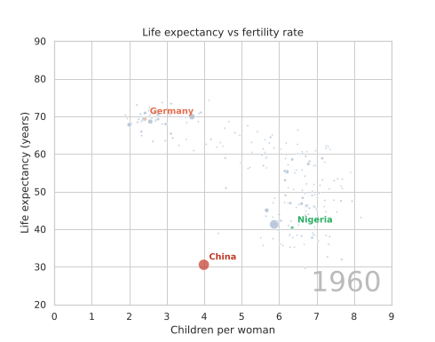

# SPICED Academy – Data Science bootcamp (2021)

Projects from the Data Science bootcamp at SPICED Academy in Berlin (April–July 2021), rebuilt in November 2026:
cleaned up, fixed to run with current libraries, and re-evaluated properly.

| Project | What it is | Main tools |
|---|---|---|
| [**disease-prediction**](disease-prediction) | Final project: predicting heart disease, diabetes and cardiovascular disease with seven classical models and a neural network, all evaluated on the same held-out test set | scikit-learn, imbalanced-learn, Keras |
| [**gapminder-visualisation**](gapminder-visualisation) | Reshaping and merging three Gapminder tables into an animated chart of life expectancy against fertility, 1960–2015 | pandas, Matplotlib |
| [**software-engineering**](software-engineering) | Unit tests, a pip-installable package, code profiling, lambda functions | pytest, setuptools, cProfile |



## Disease prediction at a glance

| Dataset | Patients | Best test ROC-AUC | Baseline accuracy → best model accuracy |
|---|---|---|---|
| Heart disease | 302 | 0.90 | 54 % → 82 % |
| Diabetes | 768 | 0.81 | 65 % → 71 % |
| Cardiovascular disease | 68,608 | 0.80 | 50 % → 73 % |

Details, method and what was fixed in the rebuild: [disease-prediction/README.md](disease-prediction/README.md)

## Setup

```bash
python -m venv .venv && source .venv/bin/activate
pip install -r requirements.txt
jupyter lab
```

The original 2021 notebooks are kept in the Git history.
