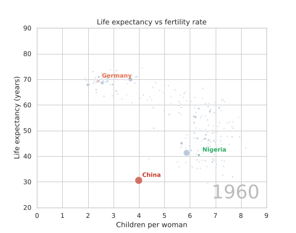

# Gapminder: life expectancy and fertility, 1960–2015

My first project in the SPICED Academy bootcamp (2021), cleaned up in November 2026.

Three Gapminder tables (fertility rate, life expectancy, population) are reshaped from wide to long format with
`pandas.melt`, merged into one table and turned into an animated scatter plot.

**Notebook:** [gapminder_animation.ipynb](gapminder_animation.ipynb)

In 1960 most countries had either few children and long lives, or many children and short lives. By 2015 most had
moved towards fewer children and longer lives. China moved early and fast, Nigeria's fertility rate stayed high.

Data: [Gapminder](https://www.gapminder.org/data/), free to use under CC BY 4.0.
